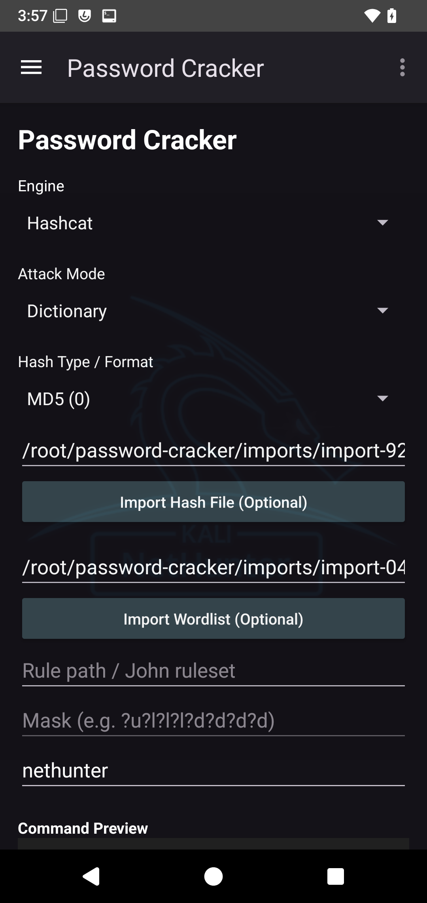

# Kali NetHunter — Custom Fork

This repository is a customized fork of the official Kali NetHunter Android application, featuring two additional integrated security tools: **SharkHunter** and **Password Cracker**.

Both modules provide native Android interfaces for tools running inside the Kali NetHunter environment.

## Custom Features

### 🦈 SharkHunter — Packet Capture & Analysis

SharkHunter is a Wireshark-inspired network packet capture and analysis interface integrated directly into the Kali NetHunter application.

It uses **TShark**, Wireshark's command-line packet analyzer, to capture and inspect network traffic.

**Features:**

- Live packet capture with network interface selection
- BPF capture filters
- Wireshark-compatible display filters
- Quick filters for TCP, UDP, DNS, HTTP, TLS, EAPOL, and ARP
- Packet inspection with protocol tree and hexadecimal/ASCII views
- Follow TCP and UDP streams
- Import and export PCAPNG capture files
- Background packet capture
- Pause and resume packet display
- Save, discard, or retain captures for later

#### SharkHunter Screenshot

### 🔐 Password Cracker — Hashcat & John the Ripper

Password Cracker provides a native Android interface for password auditing using **Hashcat** and **John the Ripper**.

The module allows users to configure and run password recovery sessions without manually constructing every command in a terminal.

**Features:**

- Hashcat and John the Ripper engine selection
- Attack mode and hash type configuration
- Hash file and wordlist selection
- Rules and mask configuration
- Command preview
- Start and stop cracking sessions
- Resume supported sessions
- Session output monitoring
- Display and copy recovered results

#### Password Cracker Configuration

#### Password Cracker Results

## Requirements

- Rooted Android device with a compatible Kali NetHunter installation
- Working Kali NetHunter chroot environment
- TShark installed for SharkHunter
- Hashcat and/or John the Ripper installed for Password Cracker

## Project Information

This project is an independently maintained customization of the Kali NetHunter Android application.

The original Kali NetHunter project is developed and maintained by Offensive Security.

**Upstream project:** https://gitlab.com/kalilinux/nethunter/apps/kali-nethunter-app

## Disclaimer

These features are intended for cybersecurity education, authorized penetration testing, password auditing, and controlled laboratory environments.

Only capture traffic or audit passwords on systems for which you have authorization.

## License

This fork retains the applicable upstream project licenses. Refer to the repository's license files for details.

