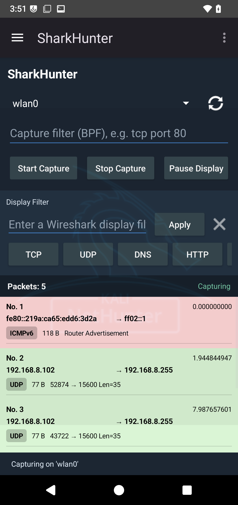
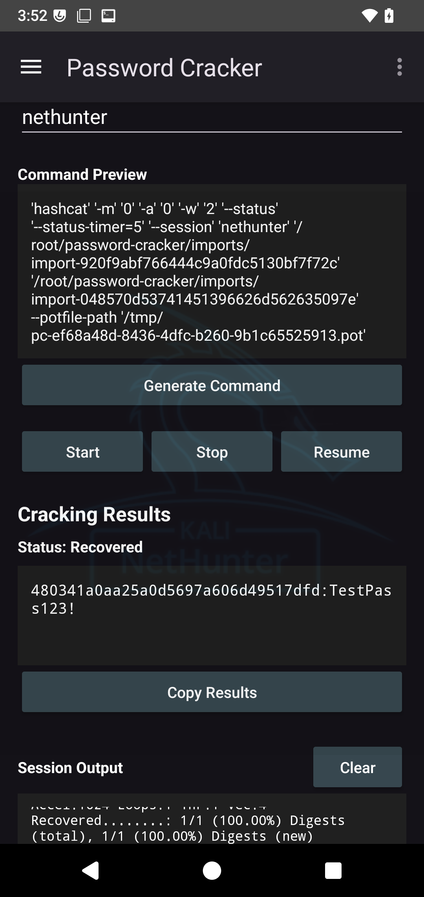

# Kali NetHunter — Custom Fork

A customized fork of the official **Kali NetHunter Android application**, featuring two additional integrated security tools:

- **SharkHunter** — A Wireshark-inspired packet capture and analysis interface powered by TShark.
- **Password Cracker** — A native Android interface for Hashcat and John the Ripper.

Both modules integrate directly into the NetHunter application, allowing users to perform security testing and analysis through Android interfaces instead of relying entirely on terminal commands.

---

## 🦈 SharkHunter — Packet Capture & Analysis

SharkHunter brings Wireshark-style packet capture and analysis directly into the Kali NetHunter Android application.

Powered by **TShark**, SharkHunter provides a graphical interface for capturing, filtering, and inspecting network traffic using the Kali NetHunter chroot environment.

### Features

- **Live Packet Capture** — Capture network traffic from selectable interfaces.
- **Capture Filters** — Apply Berkeley Packet Filter (BPF) expressions.
- **Display Filters** — Filter captured packets using Wireshark-compatible syntax.
- **Quick Filters** — TCP, UDP, DNS, HTTP, TLS, EAPOL, and ARP.
- **Packet Inspector** — Examine packet details and protocol information.
- **Hex/ASCII Viewer** — Inspect raw packet data.
- **Follow Streams** — Reconstruct TCP and UDP conversations.
- **PCAPNG Support** — Import and export packet captures.
- **Background Capture** — Continue capturing while navigating the application.
- **Pause Display** — Temporarily pause packet updates without stopping capture.
- **Capture Management** — Save, discard, or retain captures for later.

### SharkHunter Screenshot

<p align="center">
  
</p>

---

## 🔐 Password Cracker — Hashcat & John the Ripper

Password Cracker provides an integrated graphical interface for password auditing and hash recovery using **Hashcat** and **John the Ripper**.

The module simplifies configuring password recovery sessions through a native Android interface.

### Features

- **Multiple Engines** — Select Hashcat or John the Ripper.
- **Attack Configuration** — Configure supported attack modes.
- **Hash Type Selection** — Select the appropriate hash algorithm or format.
- **Hash File Selection** — Choose files containing hashes to audit.
- **Wordlist Selection** — Select dictionaries for password recovery.
- **Rules and Masks** — Configure supported rule-based and mask attacks.
- **Command Preview** — Review the generated command before execution.
- **Session Control** — Start, stop, and resume supported sessions.
- **Session Output** — Monitor execution results.
- **Recovered Passwords** — View and copy recovered credentials.

### Password Cracker Configuration

<p align="center">
  
</p>

### Password Cracker Results

<p align="center">
  
</p>

---

## Requirements

### General Requirements

- Rooted Android device
- Compatible Kali NetHunter installation
- Functional Kali NetHunter chroot environment
- Appropriate permissions for the selected security tools

### SharkHunter

SharkHunter requires **TShark** inside the Kali environment.

Install it with:

```bash
sudo apt update
sudo apt install tshark
```

Verify the installation:

```bash
tshark --version
```

### Password Cracker

Password Cracker requires Hashcat and/or John the Ripper inside the Kali environment.

Install them with:

```bash
sudo apt update
sudo apt install hashcat john
```

Verify the installations:

```bash
hashcat --version
john --version
```

Some Hashcat workloads require compatible CPU or GPU compute backends. Performance and hardware support depend on the Android device and Kali environment.

---

## How It Works

Both modules are integrated into the native Kali NetHunter Android application.

### SharkHunter

1. Launch SharkHunter from the NetHunter navigation menu.
2. Select a network interface.
3. Configure an optional capture filter.
4. Start capturing network traffic.
5. Inspect packets and apply display filters.
6. Save the capture to a PCAPNG file when finished.

### Password Cracker

1. Open Password Cracker from the NetHunter navigation menu.
2. Select Hashcat or John the Ripper.
3. Configure the attack mode and hash type.
4. Select a hash file and wordlist.
5. Configure optional rules or masks.
6. Review the command preview.
7. Start the session and inspect its output.

---

## Project Status

This repository is an independently maintained fork of the Kali NetHunter Android application.

The SharkHunter and Password Cracker modules are custom additions and are not official Kali NetHunter features.

Development and testing are ongoing. Functionality may vary depending on device compatibility, root access, the Kali environment, and installed tools.

---

## Upstream Project

This project is based on the official Kali NetHunter Android application.

**Official Kali NetHunter:**  
https://www.kali.org/docs/nethunter/

**Upstream Source Repository:**  
https://gitlab.com/kalilinux/nethunter/apps/kali-nethunter-app

**Custom Fork:**  
https://github.com/ch3dd3r-b0b/kali-nethunter-app

---

## Disclaimer

This software is intended for:

- Cybersecurity education
- Authorized penetration testing
- Network troubleshooting and analysis
- Password auditing and recovery
- Controlled security research environments

Only capture network traffic or audit credentials on systems and networks you own or are explicitly authorized to test.

---

## License

This project is a fork of Kali NetHunter and retains the applicable upstream licensing terms.

Refer to the repository's license files for additional information.

